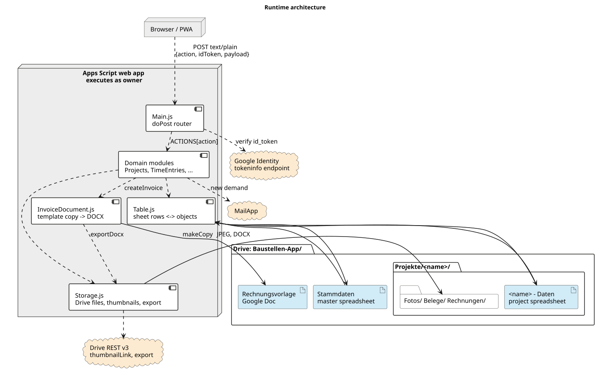
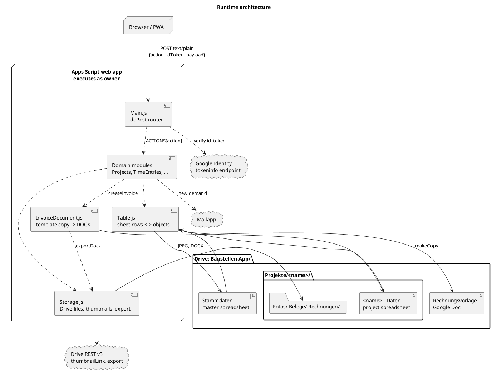
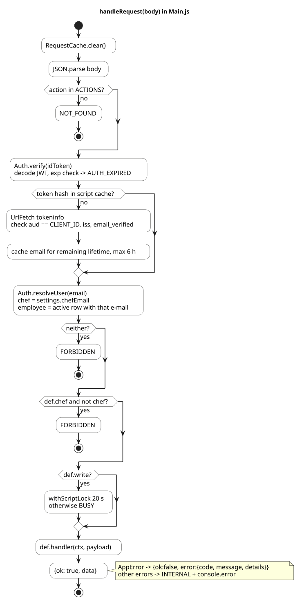
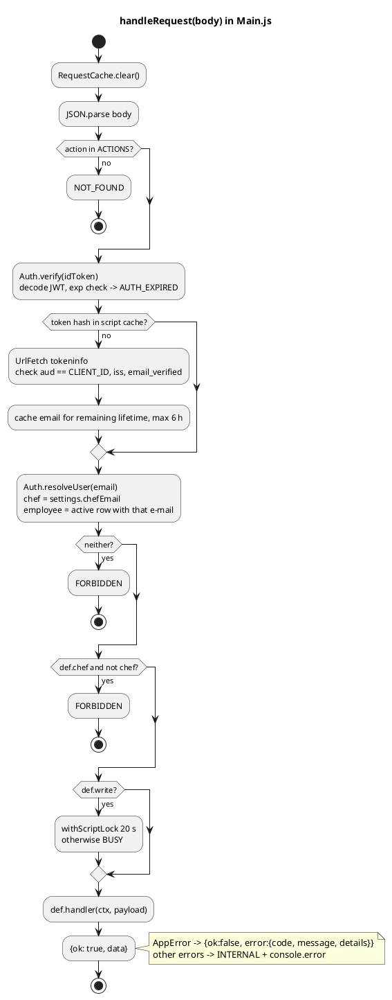
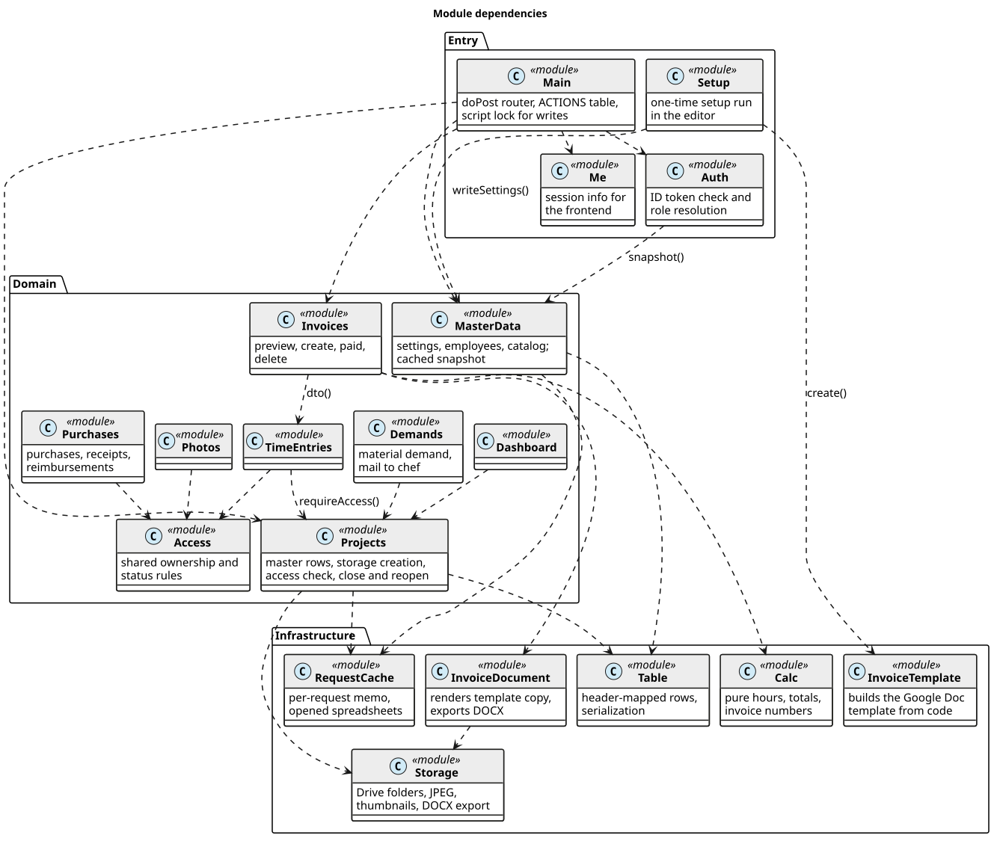
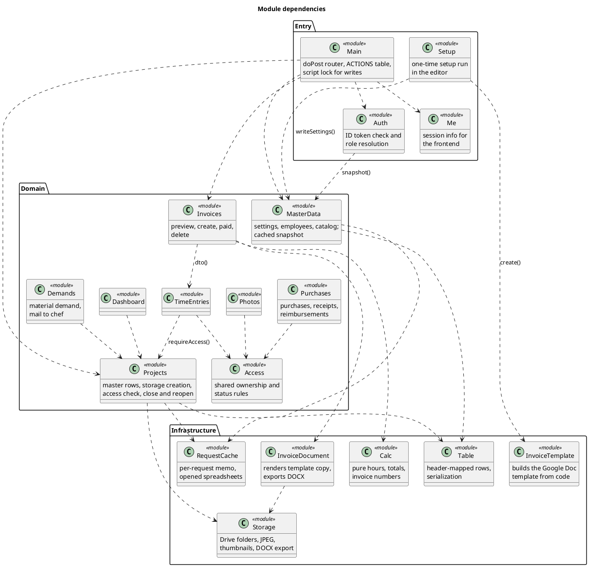
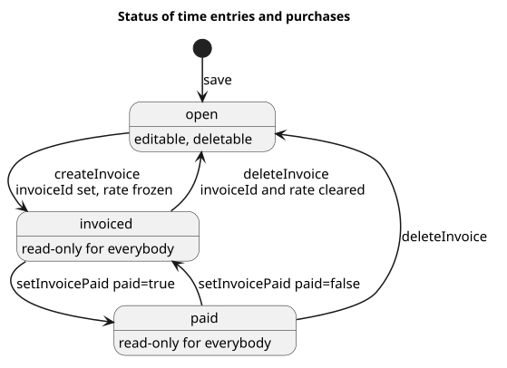
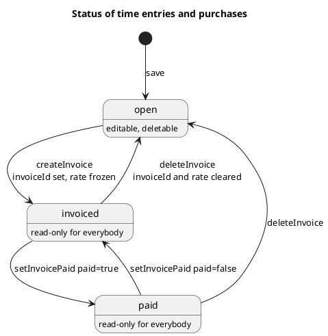
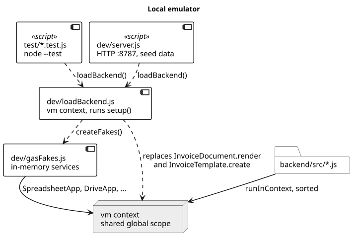
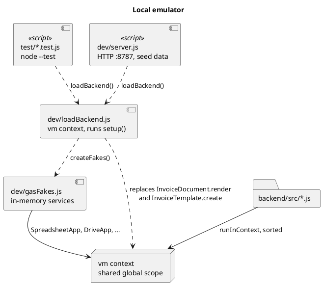

# Reference: Backend (Google Apps Script) and local emulator

Scope: `backend/` – the Apps Script web app that stores all data in the owner's Google Drive, plus the Node emulator used for tests and local development. The frontend is described in `REFERENCE.frontend.md`; the business specification is `SPEC.md`.
Conventions: paths relative to the repository root; dates `YYYY-MM-DD`, times `HH:MM`, timestamps `YYYY-MM-DDTHH:MM:SS`, all in Europe/Vienna; amounts in EUR, rounded to 2 decimals; code and identifiers English, sheet headers and user messages German.
Read the diagrams first.

## Purpose

- Single `doPost` JSON API for the PWA: verifies Google ID tokens, resolves the role (chef / employee), checks permissions, serializes writes with the script lock.
- Stores master data in one spreadsheet and each project in its own spreadsheet and Drive folder (photos, receipts, invoices as files).
- Billing: selects open hours/purchases up to a cutoff date, freezes hourly rates, renders a DOCX from a Google Doc template, tracks open → invoiced → paid.
- `setup()` creates folders, master spreadsheet with seed data and the invoice template.
- `backend/dev` runs the unchanged source files in a Node `vm` with in-memory fakes of the Apps Script services.

## Diagrams

Legend: component diagrams – solid arrow = data from writer to store or store to reader, dashed = call. Class diagrams – dashed = calls. Not drawn: constant modules `Config.js` (script properties, constants), `Schema.js` (table definitions, enums), `Errors.js` (`AppError`, `assertValid`), used everywhere.





















## Contracts and file formats

### HTTP API

- `POST <exec URL>` with `Content-Type: text/plain;charset=utf-8` (no CORS preflight, which Apps Script cannot answer). Apps Script answers with a 302 to `script.googleusercontent.com`; clients must follow redirects.
- Body `{ "action": "saveTimeEntry", "idToken": "<JWT>", "payload": { ... } }`; response `{ "ok": true, "data": ... }` or `{ "ok": false, "error": { "code", "message", "details" } }`. HTTP status is always 200.
- `GET <exec URL>` → `{"ok":true,"data":{"service":"Baustellen-App","status":"running"}}` (health check).
- Actions, `chef` = chef only, `write` = under the script lock (table `ACTIONS` in `Main.js`):

| Area | Actions |
| --- | --- |
| Session | `me` |
| Projects | `listProjects`, `getProject`, `saveProject` chef/write, `closeProject` chef/write, `reopenProject` chef/write |
| Time | `listTimeEntries`, `saveTimeEntry` write, `deleteTimeEntry` write |
| Purchases | `listPurchases`, `savePurchase` write, `deletePurchase` write, `setReimbursed` chef/write, `listMyReimbursements`, `uploadReceipt` write, `getReceipt` |
| Demand | `listDemands`, `saveDemand` write, `setDemandStatus` write |
| Photos | `listPhotos`, `getPhoto`, `uploadPhoto` write, `updatePhoto` write, `deletePhoto` write |
| Billing (chef) | `previewInvoice`, `createInvoice` write, `listInvoices`, `downloadInvoice`, `setInvoicePaid` write, `deleteInvoice` write |
| Master data (chef) | `listEmployees`, `saveEmployee` write, `listCatalog`, `saveCatalogItem` write, `deleteCatalogItem` write, `getSettings`, `saveSettings` write |
| Dashboard (chef) | `getDashboard` |

- The payload shapes are the parameter JSDoc of each handler; the frontend mirrors them in `frontend/src/api/types.ts`. Responses are the `dto()` functions of each module (rates are omitted for employees in `TimeEntries.dto`, employee projects lack markup fields in `Projects.dto`).
- Binary data (images, DOCX) travels as base64 inside JSON: `{ base64, mimeType, name }` (`Storage.readBase64`).

### Error codes

| Code | Meaning / frontend reaction |
| --- | --- |
| `AUTH_REQUIRED`, `AUTH_INVALID` | no/invalid token, wrong `aud` → login screen |
| `AUTH_EXPIRED` | JWT `exp` passed → frontend renews the token silently and repeats once |
| `FORBIDDEN` | not in employee list / inactive / chef-only action / not own entry |
| `NOT_FOUND` | unknown action or entity |
| `VALIDATION` | invalid input (German message shown to the user) |
| `CONFLICT` | entry already invoiced |
| `CONFIRM_REQUIRED` | needs consent; resend with `confirmOverlap: true` (time entry) or `confirm: true` (close project); `details` of closeProject = `{hoursCount, hours, purchasesCount, purchasesAmount}` |
| `PROJECT_CLOSED` | employee accesses a closed project |
| `BUSY` | script lock not acquired within 20 s |
| `INTERNAL` | unexpected error, logged with `console.error` (Apps Script execution log) |

### Deployment and configuration

| Item | Value |
| --- | --- |
| Script properties | `ROOT_FOLDER_ID`, `MASTER_SHEET_ID`, `TEMPLATE_DOC_ID` (written by `setup()`), `CLIENT_ID` (OAuth web client id, set manually) |
| `backend/src/appsscript.json` | V8, time zone Europe/Vienna, webapp `executeAs: USER_DEPLOYING`, `access: ANYONE_ANONYMOUS`, scopes spreadsheets, drive, documents, script.external_request, script.send_mail, userinfo.email |
| `backend/.clasp.json` | gitignored; `{"scriptId": "...", "rootDir": "src"}` (template `.clasp.json.example`) |
| Owner account | oliver.schletz@gmail.com (per user); data lives in its Drive |
| Script id | `1n4ouDliJMFu0sYdNvALNsjSrvRmO5Tj88RS3KyYuzi8ADoe-LNQwyRBk` |
| Web app deployment | `AKfycbylashdgj_ymC0jLE4dWjt6IF0BjJcIcJIDY30Ir438gl8AfYfC2z5UAKXLfLKa9MfK` → `https://script.google.com/macros/s/<id>/exec` |
| OAuth client | GCP project `zeiterfassung-514717`, web client "Baustellen-App Web" `472722239179-qo32qqjbs38g5t3cvq08g9btq14svkb1.apps.googleusercontent.com`, origins `https://schletz.github.io`, `http://localhost:5173`; consent screen in **testing** mode: every user must be a test user in Google Auth Platform → Audience (per user, max 100) |

Deploy a code change without changing the URL: `cd backend && clasp push && clasp update-deployment <deployment id>`. `clasp create-deployment` would create a new URL.

### Drive layout

```
Baustellen-App/                      ROOT_FOLDER_ID, created by setup()
├── Stammdaten                       master spreadsheet (MASTER_TABLES)
├── Rechnungsvorlage                 Google Doc, TEMPLATE_DOC_ID
└── Projekte/
    └── <project name>/              folderId in the project row; renamed with the project
        ├── <project name> – Daten   project spreadsheet (PROJECT_TABLES), sheetId in the project row
        ├── Fotos/                   Foto_<photoId>.jpg, Bedarf_<demandId>.jpg
        ├── Belege/                  Beleg_<uploadId>.jpg
        └── Rechnungen/              Rechnung <number> <project>.docx
```

### Sheet tables (`Schema.js`)

- Master: `settings` (Einstellungen, key/value/meaning), `employees` (Mitarbeiter), `projects` (Projekte), `catalog` (Leistungskatalog, id = `code`), `invoiceRegister` (Rechnungsregister, id = `number`, cross-project number uniqueness).
- Project: `timeEntries` (Zeiten), `purchases` (Materialkäufe), `demands` (Materialbedarf), `photos` (Fotos), `invoices` (Rechnungen), `invoiceItems` (Rechnungspositionen = extra positions).
- First schema column is the id. Row 1 holds German headers; columns are found by header text, so the chef may reorder columns or add own columns (preserved on update). A schema column missing in an existing sheet is appended on the next access (`Table.layout`).
- Column types and stored form: `string` text; `number`/`money` number (money rounded); `date`/`time`/`datetime` text in ISO form; `bool` `ja`/`nein`; `enum` German label (`ITEM_STATUS` open/invoiced/paid ↔ offen/verrechnet/bezahlt, `PROJECT_STATUS`, `DEMAND_STATUS`, `URGENCY`, `INVOICE_STATUS`, `PURCHASE_SOURCE`, `INVOICE_KIND` partial ↔ Zwischenrechnung …).
- Each tab gets a warning-only protection "Nur über die App ändern" and a note on A1.
- Settings keys: `chefEmail`, `materialMarkupPercent` (default 20), `reverseChargeText` (`DEFAULT_SETTINGS`).

### Invoice template placeholders (`InvoiceTemplate.js`, rendered by `InvoiceDocument.js`)

- Scalars `{{name}}` in header, body, footer: `invoiceTitle`, `invoiceNumber`, `invoiceDate`, `servicePeriod`, `cutoffDate`, `client`, `projectName`, `siteAddress`, `siteManager`, `totalHours`, `laborTotal`, `extrasTotal`, `materialBase`, `markupPercent`, `markupAmount`, `materialTotal`, `netTotal`, `vatPercent`, `vatAmount`, `grossTotal`, `reverseChargeText`.
- Repeated rows: the table row containing `{{<prefix>.` is copied per item, then removed. Prefixes: `labor.name/hours/rate/amount`, `extra.code/description/quantity/unit/unitPrice/amount`, `time.date/employee/from/to/hours/description`, `purchase.date/article/buyer/receiptNumber/amount`.
- Sections: paragraphs whose whole text is `{{#name}}` … `{{/name}}`; content removed when empty, marker paragraphs always removed. Names: `extras`, `material`, `annex` (wraps the page break and both annexes), `timeEntries`, `purchases`.
- Values are formatted de-AT by `Format.js` (`1.234,50 €`, `14.11.2026`).
- After `setup()` the chef edits company data, bank details and layout directly in the Google Doc; `resetInvoiceTemplate()` overwrites those edits.

## Command line and dependencies

| Command (in `backend/`) | Effect |
| --- | --- |
| `npm test` | `node --test test/` – calc unit tests and API flow tests against the emulator |
| `npm run dev` | `node dev/server.js` – emulator on `http://localhost:8787` (`PORT` env), reset on restart |
| `clasp push` | uploads `src/` (`.claspignore`: only `appsscript.json` and `*.js`) |
| `clasp update-deployment <id>` | points the existing web app URL to the new code |

Editor-only functions (run by the owner in the Apps Script editor): `setup()` (idempotent: does nothing if `ROOT_FOLDER_ID` points to an existing folder), `resetInvoiceTemplate()`, `setClientId()` (alternative to setting the property by hand; edit the constant first). No npm runtime dependencies; Node ≥ 20 for the emulator; `@google/clasp` 3.x global for deployment.

## API

All modules are object literals (`const X = { ... }`) or top-level functions in one shared global scope (Apps Script concatenates files; the emulator runs them in one `vm` context). Modules reference each other only inside functions, so file load order does not matter. Handlers have the signature `(ctx, payload)`, `ctx = { user: {email, role, employeeId, name, shortName}, isChef }`.

### Main (Main.js)

`handleRequest` is separate from `doPost` so the emulator and tests can call it with a raw body string. `RequestCache.clear()` runs first because the dev server keeps globals between requests (Apps Script does not).

| Method | Summary |
| --- | --- |
| `doPost(e)`, `doGet()` | web app entry points, JSON via `ContentService` |
| `handleRequest(body) -> {ok, data/error}` | see diagram `backend-request` |
| `withScriptLock(fn)` | `LockService.getScriptLock().tryLock(20000)`, else `BUSY` |

### Auth (Auth.js)

The payload is decoded locally only for a cheap `exp` check; trust comes from `tokeninfo`. Cache key `tok_` + SHA-256 of the token, TTL = remaining lifetime (≤ 21600 s, CacheService maximum). `resolveUser` compares e-mails case-insensitively; the chef may also be an employee (then `employeeId` is set), a chef without employee row has `employeeId = ''` and must pick an employee when recording hours.

| Method | Summary |
| --- | --- |
| `verify(idToken) -> email` | expiry, tokeninfo, `aud == CLIENT_ID`, issuer, `email_verified` |
| `resolveUser(email) -> user` | role from `settings.chefEmail` and active employees, else `FORBIDDEN` |

### MasterData (MasterData.js)

Settings and employees are needed on every request; they are cached as one JSON in the script cache (`master_snapshot_v1`, 300 s) and in `RequestCache`. Every write to settings/employees calls `invalidate()`. Employees are never deleted (references in project sheets), only `active = false`.

| Field | Meaning |
| --- | --- |
| `DEFAULT_SETTINGS` | chefEmail '', materialMarkupPercent 20, reverseChargeText § 19 Abs. 1a UStG |
| `DEFAULT_CATALOG` | 5 start entries from the former Excel (STD-MEISTER 30, STD-MONTEUR 25, STD-HELFER 20, PAUSCH-ANFAHRT 45, PRUEF-EBEF 180) |

| Method | Summary |
| --- | --- |
| `snapshot() / settings() / employees() / employeeById(id)` | cached reads |
| `saveEmployee`, `saveCatalogItem` (`originalCode` renames), `deleteCatalogItem`, `saveSettings` | upserts with validation; e-mail and code unique |
| `writeSettings(values)` | key/value upsert, used by `setup()` too |

### Projects (Projects.js)

`requireAccess(ctx, projectId)` is the single gate for every project-scoped action: employees get `PROJECT_CLOSED` for non-active projects. Project names are unique case-insensitively and must not contain `/` or `\`; renaming renames folder and spreadsheet. `createStorage` creates the spreadsheet in My Drive, adds all project tabs, deletes the default tab, then moves the file into the folder.

| Method | Summary |
| --- | --- |
| `all() / byId(id)` | project rows, memoized per request |
| `spreadsheet(project)` | opened once per request |
| `markupPercent(project)` | project override or settings default |
| `list`, `get`, `save`, `close` (`confirm`), `reopen` | handlers |
| `openItems(project)` | counts and sums of open hours/purchases |

### Access (Access.js)

| Method | Summary |
| --- | --- |
| `targetEmployee(ctx, requestedId)` | employees always themselves; chef chooses, default own employee id |
| `assertEditable(ctx, row, ownerId)` | own entry (unless chef) and status `open`, else `FORBIDDEN` / `CONFLICT` |
| `assertOwner(ctx, ownerId)` | ownership only (photos) |

### TimeEntries, Purchases, Demands, Photos

- Every save uses the client-generated UUID as row id: unknown id → insert, known id → update. Retries are therefore idempotent.
- `TimeEntries.save`: date ≤ today, `to > from`, hours = `Calc.hours` (quarter hours, no break). Overlap check only against entries of the same employee and day **in the same project**; cross-project overlaps are not detected (opening all project sheets per save is too slow).
- `Purchases`: amount is the gross till amount; `receiptFileId` must lie in the project's `Belege/` folder (`Storage.isInFolder`). Replacing or removing a receipt trashes the old file. `setReimbursed` takes either `projectId` + `ids` or `employeeId` alone (all unreimbursed purchases of that employee in all projects). `listMyReimbursements` reads all projects, including closed ones, without `requireAccess`.
- `Demands.save` only creates (existing id → returns the row) and mails the chef; mail errors are logged, not raised. `setStatus`: chef any status; employee only `done` on own reports (`reporterId`).
- `Photos.update` with new image: DriveApp cannot overwrite binary content, so a new file is created, the old one trashed and `fileId` changes. `list` returns thumbnails via `Storage.thumbnails`; `thumbnail` is null while Drive has not generated one.
- `getPhoto` accepts `photoId` or `demandId`; `getReceipt` is restricted to the buyer and the chef.

### Invoices (Invoices.js)

`prepare()` is shared by preview and create: open items with `date <= cutoff`, filtered by the given id lists (missing lists = all candidates), current employee rates, `Calc.invoice`. `create` rejects the request if any selected id is no longer open (counts differ), checks the number (`/^[\w./-]+$/`, unique in the register, case-insensitive), renders the DOCX **before** changing any row and trashes it if a later write fails. An existing invoice id returns the stored invoice (idempotent). Rates are frozen into `timeEntries.rate`; purchases need no freezing.

| Method | Summary |
| --- | --- |
| `preview(ctx, sel)` | candidates, calc, `suggestedNumber`, `defaultKind` (`partial` for active, `final` for closed projects), catalog |
| `create(ctx, p) -> {invoice, file}` | see intro; `file` = base64 DOCX for immediate download |
| `list`, `download`, `setPaid` (`paid`, `paidAt`), `remove` | status transitions as in diagram `backend-item-status`; remove also deletes positions and register row and trashes the DOCX |

### Calc and Format (Calc.js, Format.js)

Pure functions, unit tested. `Calc.invoice` sums hours per employee first, then multiplies by the rate and rounds per employee line; materialBase = sum of gross amounts; markup = base × percent; net = labor + extras + base + markup; VAT always 0 (reverse charge). `Util.round2` adds `Number.EPSILON` (1.005 → 1.01). `nextInvoiceNumber(numbers, year)` = highest `YYYY-NNN` of the year + 1, zero-padded to 3.

### Table (Table.js)

Every write sets number formats for the written cells: `@` (plain text) for all non-numeric columns, otherwise Sheets turns `2026-11-14` or `08:30` into dates. Reads still normalize `Date` values (detected with `Object.prototype.toString`, which also works across vm realms). Strings starting with `=`, `+`, `-`, `@` are written with a leading apostrophe (formula injection guard; Sheets does not store the apostrophe). Rows with an empty id are skipped silently, rows that fail deserialization are skipped with `console.warn`. Read rows carry non-enumerable `_row` and `_raw`; they are valid only within the same locked request.

| Method | Summary |
| --- | --- |
| `ensureSheet(ss, key)` | creates tab with headers, formats, protection |
| `read(ss, key) / find(ss, key, id)` | objects in schema field names |
| `insert / insertMany` | append; `ensureCapacity` first because `getRange` beyond `maxRows` throws |
| `update(ss, key, rows)` | ≤ 3 rows individually, more as one block write |
| `remove(ss, key, rows)` | `deleteRow` descending; keeps spare rows because Sheets refuses to delete all non-frozen rows |

### Storage (Storage.js)

| Method | Summary |
| --- | --- |
| `projectFolder(project, 'photos'/'receipts'/'invoices')` | subfolder, created if missing |
| `saveJpeg(folder, name, base64)` | idempotent by file name; `Util.jpegBlob` checks the JPEG SOI marker and 8 MB limit |
| `thumbnails(fileIds)` | `fetchAll` of `files/{id}?fields=thumbnailLink`, size `=s220` replaced by `=s400`, script cache `thumb_<id>` 6 h if < 95 000 chars (100 KB cache limit) |
| `exportDocx(docId, name)` | Drive v3 export with `ScriptApp.getOAuthToken()` |
| `isInFolder`, `readBase64`, `trash`, `forgetThumbnail` | helpers; `trash` ignores missing files |

### InvoiceDocument and InvoiceTemplate

Placeholders are replaced with `findText` + `insertText`/`deleteText` instead of `replaceText`, so values are literal (no regex replacement semantics) and keep formatting. Values have newlines replaced by spaces and `{{` defused to `{ {` (otherwise the replace loop could not terminate). The template must end with a paragraph outside any section: Google Docs cannot remove the last paragraph of a body. The temporary copy is trashed in `finally`.

| Method | Summary |
| --- | --- |
| `InvoiceDocument.render(data) -> {fileId, blob, name}` | copy template into `Rechnungen/`, sections, rows, scalars, export, store DOCX |
| `InvoiceDocument.fileName(number, project)` | `Rechnung <number> <project>.docx`, file-system-unsafe characters replaced |
| `InvoiceTemplate.create(folder) -> docId` | builds the layout (A4 widths sum to 491 pt) |
| `resetInvoiceTemplate()` | new template, property updated, old one trashed |

### RequestCache, Util, Dashboard, Me

`RequestCache.get(key, factory)`, `spreadsheet(id)`; `Util` date/number/blob helpers; `Dashboard.get` reads all active projects (option `includeClosed`), sums per status, hours per employee, open demands (urgent, then open before ordered, then oldest) and unreimbursed purchases per buyer; `Me.get` returns role, own employee and, for the chef, the employee list for selection fields.

### Emulator (backend/dev)

| File | Summary |
| --- | --- |
| `gasFakes.js` `createFakes(opts)` | DriveApp, SpreadsheetApp (sheets as 2-D arrays, `maxRows` 1000, `deleteRow` shrinks it), Utilities (signed byte arrays like Apps Script), CacheService, PropertiesService, LockService, Session, ContentService, MailApp (collects into `state.mails`), UrlFetchApp, ScriptApp. Unknown formatting methods are chainable no-ops (`lenient` proxy). |
| `gasFakes.js` `devToken(email, clientId, lifetime)` | unsigned JWT accepted by the fake tokeninfo |
| `loadBackend(opts) -> {run, call, token, fakes, context}` | loads `src/*.js`, replaces `InvoiceDocument.render` (writes a text file named `.docx`) and `InvoiceTemplate.create`, runs `setup()`, sets `CLIENT_ID`; `call(action, email, payload)` returns the parsed response |
| `server.js` | seeds chef@example.com (also employee), max@example.com, eva@example.com, two projects and sample entries; 300 ms artificial latency; CORS `*` |

Fake URL routes: `oauth2.googleapis.com/tokeninfo`, `drive/v3/files/{id}?fields=thumbnailLink` (link `fake://thumb/<id>` returns the file bytes), `drive/v3/files/{id}/export` (fake bytes). Everything else returns 404.

## Errors

| Situation | Behavior |
| --- | --- |
| `CLIENT_ID` property missing | every request fails with `INTERNAL` "Script-Property CLIENT_ID fehlt" |
| Chef changes `chefEmail` to another account | own chef rights end immediately (frontend asks first and signs out) |
| Manual edit produces an invalid cell (e.g. text in Betrag) | row skipped on read with `console.warn`; it disappears from the app until fixed |
| Drive has not generated a thumbnail yet | `thumbnail: null`, frontend shows "Vorschau folgt" |
| Selected invoice item changed meanwhile | `VALIDATION` "Einige gewählte Posten sind nicht mehr offen" |
| Demand mail quota (100/day) exhausted | demand is saved, mail error only logged |

## Pitfalls

- `clasp create-script` overwrites `src/appsscript.json` with a default manifest (New York time zone, no webapp section). Restore it from git before `clasp push`.
- Values shared with the frontend must stay in sync: `Calc.hours` ↔ `frontend/src/lib/hours.ts`; DTO shapes ↔ `frontend/src/api/types.ts`; status enum codes ↔ `frontend/src/lib/format.ts` labels; error codes `CONFIRM_REQUIRED` / `AUTH_*` ↔ `frontend/src/api/ApiError.ts`.
- `DocumentApp` is not emulated. Changes to `InvoiceDocument` or `InvoiceTemplate` are only testable in the real deployment (create an invoice, open the DOCX).
- Objects returned from the emulator `vm` have foreign prototypes: `assert.deepEqual` fails on them; compare after a JSON round trip (`call` already does this).
- Apps Script globals do not survive between executions, but the emulator's do: per-request state belongs in `RequestCache`.
- Top-level names share one namespace with Apps Script built-ins: never name a module `Session`, `Utilities`, `Logger` etc.
- OAuth consent screen is in testing mode: a new employee needs both an active row in Mitarbeiter and a test-user entry in the Cloud Console.

## Extension recipes

- **New action:** handler in the domain module (validate with `assertValid`, gate with `Projects.requireAccess`), entry in `ACTIONS` with `chef`/`write` flags, typed wrapper in `frontend/src/api/api.ts` and DTO in `frontend/src/api/types.ts`, test in `backend/test/api.test.js`.
- **New sheet column:** add to `SCHEMA` (header text = what the chef sees); existing sheets get the header appended automatically. Extend the module's `dto()` and the frontend type.
- **New table:** add to `SCHEMA` and to `MASTER_TABLES` or `PROJECT_TABLES`; tabs are created lazily by `Table.ensureSheet` on first read.
- **Template change:** edit `InvoiceTemplate.create` and, for new placeholders, `InvoiceDocument.scalars` / `expandRows` calls; deploy, then run `resetInvoiceTemplate()` (chef's manual edits in the old doc are lost – tell the user).
- **Deploy backend:** `npm test`, then `clasp push`, then `clasp update-deployment AKfycbylashdgj_ymC0jLE4dWjt6IF0BjJcIcJIDY30Ir438gl8AfYfC2z5UAKXLfLKa9MfK`. New OAuth scopes in the manifest require the owner to re-authorize once in the editor.
