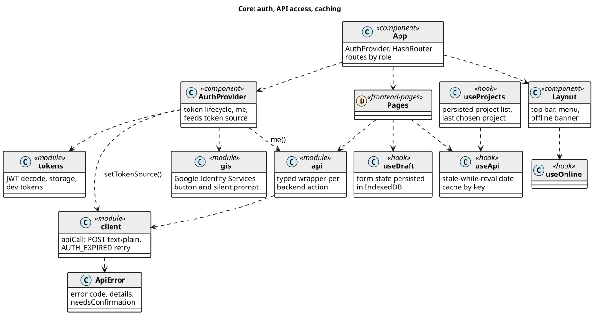
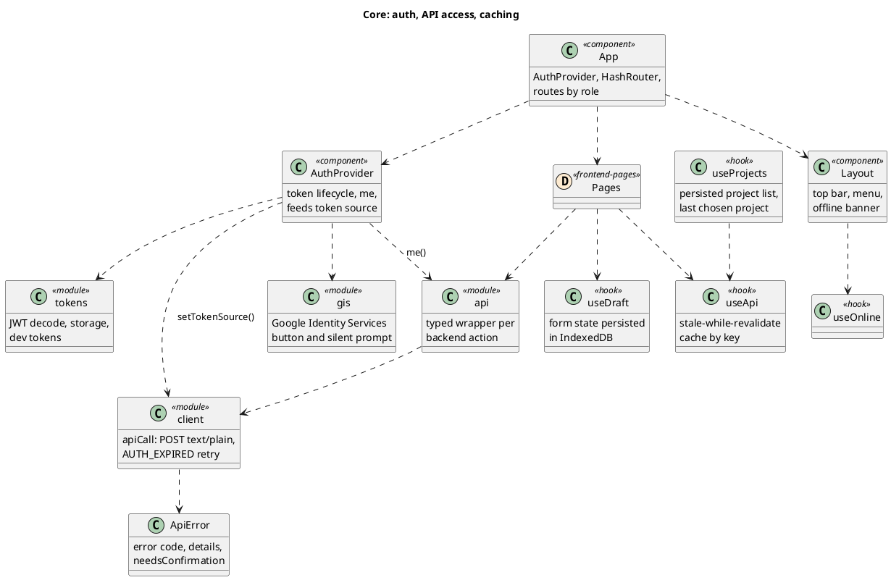
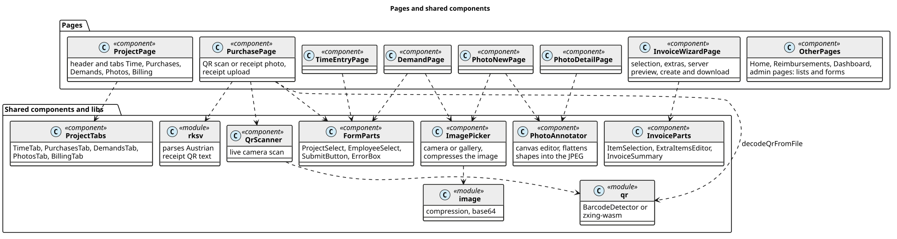
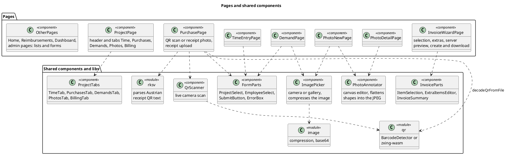
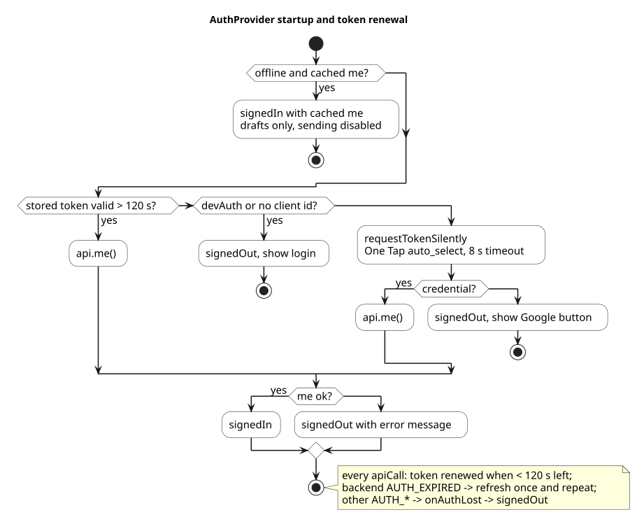
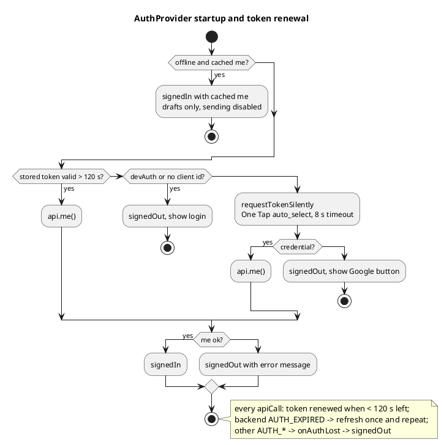

# Reference: Frontend (React PWA)

Scope: `frontend/` – the mobile-first PWA served from GitHub Pages, plus the deploy workflow `.github/workflows/deploy-pages.yml`. The backend API it calls is described in `REFERENCE.backend.md`; the business specification is `SPEC.md`.
Conventions: paths relative to the repository root; React 19, Vite 8, TypeScript 7, react-router 7 (`HashRouter`), vite-plugin-pwa 2; UI text German, code English; one exported component per file.
Read the diagrams first.

## Purpose

- Employees: record hours, material purchases (RKSV QR code from the receipt), missing material, annotated site photos; see own reimbursements.
- Chef additionally: dashboard, project/employee/catalog/settings management, invoice wizard and invoice list.
- Works on phones as installable PWA; unsent form input (including photos) survives offline periods in IndexedDB; sending needs network.

## Diagrams

Legend: dashed arrow = uses / calls; stereotypes `<<component>>` React component, `<<hook>>` React hook, `<<module>>` functions only. Constant-only module not drawn: `config.ts` (env values).

## Contracts and file formats

### Build configuration

| Variable | Where | Meaning |
| --- | --- | --- |
| `VITE_API_URL` | GitHub Actions variable; `frontend/.env.development` = `http://localhost:8787` | backend `/exec` URL (production: see `REFERENCE.backend.md`) |
| `VITE_GOOGLE_CLIENT_ID` | GitHub Actions variable; dev = `dev-client-id` | OAuth web client id for GIS |
| `VITE_DEV_AUTH` | dev only (`true`) | login by e-mail with unsigned tokens; only the emulator accepts them, the real backend rejects them |
| `VITE_BASE` | workflow sets `/<repo>/` | Vite `base`; default `/` |

`frontend/.env.development` applies only to `npm run dev`. To develop against the real backend create `frontend/.env.development.local` (gitignored) with the real URL, client id and `VITE_DEV_AUTH=false`; the origin `http://localhost:5173` is authorized at the OAuth client.

### Backend contract

`client.ts` sends `POST` with `Content-Type: text/plain;charset=utf-8`, body `{action, idToken, payload}`, `redirect: 'follow'`; expects `{ok, data}` / `{ok:false, error}`. DTOs in `api/types.ts` mirror the backend `dto()` functions; `api/api.ts` has one wrapper per action. Files arrive as `{base64, mimeType, name}`.

### Browser storage

| Key | Store | Content |
| --- | --- | --- |
| `baustelle.idToken` | localStorage | current Google ID token (≈ 1 h lifetime) |
| `baustelle.me` | localStorage | last `me` response, used for offline start |
| `baustelle.lastProject` | localStorage | last project chosen in a form |
| `baustelle.cache.<key>` | localStorage | persisted `useApi` entries (`projects`, `project:<id>`) |
| `draft:time`, `draft:purchase`, `draft:demand`, `draft:photo` | IndexedDB (idb-keyval) | unsent form state incl. image blobs; edit forms use no draft |

### Routes (`App.tsx`, hash based)

| Route | Page |
| --- | --- |
| `/` | HomePage: quick actions, active projects (chef also closed ones) |
| `/projects/:projectId?tab=time\|purchases\|demands\|photos\|billing` | ProjectPage |
| `/projects/:projectId/photos/:photoId` | PhotoDetailPage |
| `/time?project=&edit=`, `/purchase?project=&edit=`, `/demand?project=`, `/photo?project=` | entry forms (`edit` = id of an existing entry) |
| `/reimbursements` | ReimbursementsPage |
| chef: `/dashboard`, `/admin/projects`, `/admin/projects/:projectId` (`new` creates), `/projects/:projectId/invoice`, `/admin/employees`, `/admin/catalog`, `/admin/settings` | chef pages; routes are not registered for employees |

### PWA and deployment

- `vite.config.ts`: `registerType: 'autoUpdate'`, Workbox precaches `js,css,html,svg,png,wasm` up to 6 MB (the zxing WASM is ≈ 950 kB), `navigateFallback: 'index.html'`. Icons `public/icon-192.png`, `icon-512.png`, `apple-touch-icon.png` are rendered from `public/icon.svg` (`resvg icon.svg icon-512.png -w 512 -h 512`).
- `deploy-pages.yml`: on push to `main` touching `frontend/**`; Node 24, `npm install` (not `npm ci`: the Windows-generated lockfile lacks the dependencies of the optional wasm32 Rolldown binding and `npm ci` rejects it on Linux), `npm test`, `npm run build` with the two variables and `VITE_BASE`, upload and deploy Pages. Live URL `https://schletz.github.io/TimeManagement/`.

## Command line and dependencies

| Command (in `frontend/`) | Effect |
| --- | --- |
| `npm run dev` | Vite on `http://localhost:5173` (strict port; needs the emulator: `node backend/dev/server.js`) |
| `npm run build` | `tsc --noEmit` + `vite build` into `dist/` |
| `npm test` | Vitest, `src/lib/lib.test.ts` (hours, RKSV, format) |
| `npm run typecheck` | `tsc --noEmit` |

Runtime dependencies: react, react-dom, react-router-dom, idb-keyval, zxing-wasm. `.claude/launch.json` defines the preview servers `backend-emulator` and `frontend`.

## API

### Auth (auth/AuthContext.tsx, auth/gis.ts, auth/tokens.ts)

`AuthProvider` registers the token source for `client.ts` inside a `useState` initializer, i.e. during the first render: child effects run before parent effects, so a `useEffect` registration would be too late for the first API calls of children. GIS is initialized once with `auto_select`, `use_fedcm_for_prompt`, `itp_support`; `requestTokenSilently` resolves with the next credential callback or rejects after 8 s. Sign-out clears token, cached `me` and the `useApi` cache and calls `disableAutoSelect`. A FedCM "NetworkError" in the console during the silent attempt is normal when no sign-in was confirmed yet.

| Member | Summary |
| --- | --- |
| `useAuth() -> {state, me, isChef, devSignIn, signOut, refreshMe}` | `state.status` loading / signedOut (+error) / signedIn (+me) |
| `useMe()` | `me`, throws outside signed-in subtree |
| `RENEW_BEFORE_SECONDS = 120` | tokens are renewed before use when less time is left |
| `refreshMe()` | reloads `me`, e.g. after the chef changed employees (`EmployeeSelect` reads `me.employees`) |
| `createDevToken(email, clientId)` | unsigned JWT for the emulator |

### API client (api/client.ts, api/ApiError.ts, api/api.ts)

| Member | Summary |
| --- | --- |
| `apiCall<T>(action, payload)` | `OFFLINE` without network, `NETWORK` on fetch failure; `AUTH_EXPIRED` → `refreshToken()` and one retry; other `AUTH_*` → `onAuthLost` |
| `ApiError.needsConfirmation` | `code === 'CONFIRM_REQUIRED'` |
| `withConfirmation(action)` (lib/confirm.ts) | calls `action(false)`; on `CONFIRM_REQUIRED` asks `window.confirm(message)` and calls `action(true)`; returns null when declined |

### Data hooks (hooks/)

`useApi` shows cached data immediately and refetches on mount and on key change (stale-while-revalidate). `invalidate(prefix)` only drops cache entries; it does not trigger refetches in mounted components, so a page that changes data also calls its own `reload()` or `setData()`. Cache keys in use: `projects`, `project:<id>` (both persisted), `time:<pid>`, `purchases:<pid>`, `demands:<pid>`, `photos:<pid>`, `invoices:<pid>`, `reimbursements`, `dashboard:<includeClosed>`, `employees`, `catalog`, `settings`.

| Member | Summary |
| --- | --- |
| `useApi(key, fetcher, {persist}) -> {data, error, loading, reload, setData}` | `key` null disables loading |
| `useDraft(key, create) -> {value, update, clear, ready, restored}` | IndexedDB write debounced 300 ms; `clear()` deletes the draft and creates a fresh one (new UUID); `key` null = no persistence |
| `useProjects()`, `getLastProjectId()`, `setLastProjectId()` | persisted project list, remembered project |
| `useOnline()` | `navigator.onLine` with events |

### Entry forms (pages/TimeEntryPage.tsx, PurchasePage.tsx, DemandPage.tsx, PhotoNewPage.tsx)

Each new entry gets its UUID when the draft is created; resending after an error reuses it, so the backend upsert is idempotent. A draft is cleared only after a successful save. `SubmitButton` is disabled while busy or offline.
- Time: hours preview via `quarterHours`; overlap warning via `withConfirmation` (`confirmOverlap`). The chef sees `EmployeeSelect`.
- Purchase: live scan (`QrScanner`) or receipt photo; the photo is compressed for upload while the **original file** is passed to `decodeQrFromFile` (better QR recognition). A parsed RKSV code sets amount, date (capped at today), cash register id and receipt number, `source = 'qr'`. Upload order: `uploadReceipt` (id `receiptUploadId`, stored in the draft with the returned `receiptFileId`), then `savePurchase`.
- Photo: picking an image opens `PhotoAnnotator` immediately; `takenAt` = file `lastModified`. Detail page: further annotation uploads the flattened JPEG via `updatePhoto` (backend replaces the file).

### Invoice wizard (pages/admin/InvoiceWizardPage.tsx, pages/admin/invoice/)

Candidates come from `previewInvoice` without id lists (all open items ≤ cutoff, all preselected); changing the cutoff reloads and reselects all. Totals are always computed by the backend: the preview is stored with `JSON.stringify(selection)` as key and "create" is enabled only while that key equals the current selection. The invoice UUID is generated once per page mount (idempotent retry). After creation the returned DOCX is downloaded (`lib/download.ts`) and the time/purchase/invoice caches are invalidated.

### Libraries (lib/)

| Module | Summary |
| --- | --- |
| `hours.ts` `quarterHours(from, to)` | `round(minutes / 15) * 0.25`, null if invalid or `to <= from`; must match backend `Calc.hours` |
| `rksv.ts` `parseRksv(text)` | `_R1-AT…_<register>_<receipt>_<ISO datetime>_<5 gross amounts>_…`; amounts with decimal comma summed in cents; null for other QR codes |
| `qr.ts` | `BarcodeDetector` when it supports `qr_code`, else `zxing-wasm/reader` with the bundled WASM (`?url` import + `locateFile`, no CDN); `decodeQrFromVideo` used every 350 ms by `QrScanner` |
| `image.ts` | `compressImage` max 2560 px long edge, JPEG 0.8, EXIF orientation via `createImageBitmap({imageOrientation: 'from-image'})` with `` fallback; base64 helpers |
| `annotation.ts` | shapes pen/ellipse/rect/arrow/text in image pixels; widths 0.4 / 0.8 / 1.5 % of the long edge, text size = 7 × width; dark shadow keeps light colors visible |
| `format.ts` | `Intl` de-AT (money renders as `€ 1.234,50`, unlike the DOCX format of the backend), status labels |
| `download.ts`, `uuid.ts`, `confirm.ts` | file download via object URL, UUID with fallback, see above |

### PhotoAnnotator (components/PhotoAnnotator.tsx)

The canvas has the image's natural size and is scaled by CSS; pointer coordinates are mapped with `getBoundingClientRect`, `touch-action: none` prevents scrolling while drawing. Redraw happens once per animation frame. "Übernehmen" without any shape returns the original blob (no re-encoding).

## Errors

| Situation | Behavior |
| --- | --- |
| Backend unreachable / offline | `NETWORK` / `OFFLINE` message, draft stays, submit disabled while offline |
| Silent sign-in fails (new device, cookies blocked, FedCM) | login page with Google button |
| User not in employee list | `FORBIDDEN` message on the login page |
| Employee opens a closed project | `PROJECT_CLOSED` message (cached project data may still be shown) |
| QR not found or not RKSV | hint text, manual amount entry |
| Camera permission denied in `QrScanner` | message in the overlay; receipt photo still possible |

## Pitfalls

- Keep in sync with the backend: DTOs (`api/types.ts`), `quarterHours` ↔ `Calc.hours`, status codes/labels (`lib/format.ts`, `StatusBadge`) ↔ `Schema.js` enums.
- `HashRouter` is required: GitHub Pages cannot rewrite deep links to `index.html`. Asset references in `index.html` and `Layout` use relative paths (`./icon.svg`) so they work under `/<repo>/`.
- Number inputs are text with `inputMode="decimal"` and parsed by `parseDecimal` (decimal comma); `type="number"` would reject commas on some phones.
- A real Google login works only on origins listed at the OAuth client (`https://schletz.github.io`, `http://localhost:5173`) and only for test users of the consent screen.
- The service worker serves the old build until the next load after deploy (`autoUpdate`); verify deployments with a reload.

## Extension recipes

- **New page:** component in `pages/`, route in `App.tsx` (inside the `isChef` block for chef pages), menu link in `Layout.tsx`.
- **New backend action:** wrapper in `api/api.ts`, types in `api/types.ts`; see the backend recipe in `REFERENCE.backend.md`.
- **New form with offline draft:** `useDraft('draft:<name>', create)` with `id: uuid()` in `create`, `SubmitButton`, `draft.clear()` after success, `invalidate()` of the affected list key.
- **New cached list:** pick a key `<entity>:<projectId>`, pass `{persist: true}` only for data needed offline.
